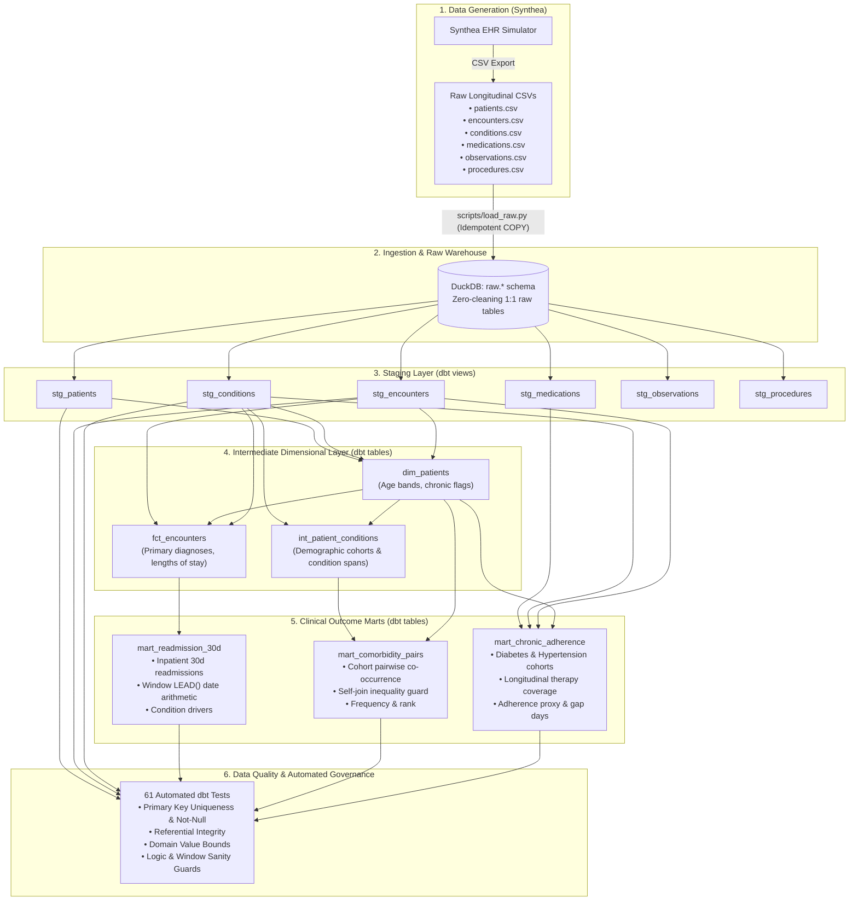

# Patient Data Pipeline: Synthea → dbt → Clinical Outcome Marts

An end-to-end, production-grade healthcare data engineering pipeline that ingests raw synthetic Electronic Health Record (EHR) data generated by Synthea, loads it into an analytical warehouse (DuckDB), transforms it through modular dbt layers (Staging → Intermediate → Marts), enforces rigorous automated data-quality tests, and publishes clinical outcome data marts designed for healthcare analytics and commercial reporting teams.

---

## 1. Architecture & Pipeline Lineage



---

## 2. Tech Stack

- **Storage & Engine**: **DuckDB** (Columnar OLAP database, embedded zero-infrastructure setup, native analytical SQL support).
- **Transformation Framework**: **dbt Core** (v1.8+ / v1.12+) + `dbt-duckdb` adapter.
- **Data Quality**: **dbt-utils** + native dbt test framework (61 automated schema and business logic tests).
- **Language**: Python 3.10+ (for ingestion and pipeline orchestration) & ANSI SQL.
- **Source Data**: Synthea Patient Population Simulator (synthetic longitudinal records).

---

## 3. Quickstart & Cold Setup

### Prerequisites
- Python 3.10 or later
- Git

### Installation & Execution

```bash
# 1. Clone repository & navigate to directory
git clone https://github.com/adityamishra/patient-data-pipeline.git
cd snythea

# 2. Install dependencies
pip install -r requirements.txt

# 3. Download synthetic EHR data
python scripts/fetch_data.py

# 4. Ingest raw data into DuckDB warehouse
python scripts/load_raw.py

# 5. Install dbt packages (dbt_utils)
python -c "from dbt.cli.main import dbtRunner; dbtRunner().invoke(['deps', '--profiles-dir', '.'])"

# 6. Run transformations & build marts
python -c "from dbt.cli.main import dbtRunner; dbtRunner().invoke(['run', '--profiles-dir', '.'])"

# 7. Execute complete data-quality test suite
python -c "from dbt.cli.main import dbtRunner; dbtRunner().invoke(['test', '--profiles-dir', '.'])"
```

*Alternatively, run the full pipeline with a single command:*
```bash
python scripts/run_pipeline.py
```

---

## 4. Clinical Outcome Marts & Real Findings

All numbers below were computed directly by dbt against the synthetic population cohort:

| Mart | Metric / Question | Actual Computed Finding | Clinical Interpretation |
| :--- | :--- | :--- | :--- |
| **`mart_readmission_30d`** | 30-Day Inpatient Readmission Rate | **33.57%** (617 readmissions across 1,838 index inpatient admissions; avg 18.3 days to readmit) | High-acuity oncology (`Small cell lung neoplasm` at **96.8%**) and complex acute encounters drive rapid hospital readmissions, highlighting key intervention points for discharge planning. |
| **`mart_comorbidity_pairs`** | Top Co-occurring Comorbidity (60+ Elderly Cohort, N = 390) | **Obesity + Viral Sinusitis** (**43.85%** cohort prevalence, 171 patients), followed by **Anemia + Prediabetes** (**39.74%**, 155 patients) | Metabolic risk factors (obesity, prediabetes) strongly cluster with respiratory vulnerability and chronic inflammatory conditions in older cohorts. |
| **`mart_chronic_adherence`** | Antihypertensive & Antidiabetic Longitudinal Coverage | **99.8%** adherence proxy for Hypertension (302/302 active on therapy, 22.6 avg gap days); **96.55%** adherence proxy for Diabetes | Antihypertensive therapy displays continuous maintenance in synthetic records, whereas diabetic therapy exhibits episodic gaps and regimen transitions (averaging 237.7 gap days). |

---

## 5. Data Quality & Governance Framework

The project enforces **61 automated tests** across staging, intermediate, and outcome layers:

1. **Structural Checks**:
   - `unique` and `not_null` assertions on all primary/surrogate keys across all tables.
2. **Domain Validations**:
   - `accepted_values` enforcement on encounter classes (`ambulatory`, `inpatient`, `emergency`, `wellness`, `outpatient`, `urgentcare`), gender (`M`, `F`), condition values, and binary flags (`0`, `1`).
3. **Referential Integrity**:
   - `relationships` tests ensuring every clinical event (`encounters`, `conditions`, `medications`, `observations`, `procedures`, and marts) connects to an existing patient in `dim_patients`.
4. **Clinical Logic Guards**:
   - `dbt_utils.expression_is_true` validations:
     - `index_discharge_date >= index_admission_date` (chronological validity)
     - `readmit_flag = 0 OR (days_to_readmit >= 0 AND days_to_readmit <= 30)` (readmission window boundary enforcement)
     - `condition_a < condition_b` (strict inequality guard preventing pairwise duplicate reflections)
     - `adherence_proxy >= 0.0 AND adherence_proxy <= 1.0` (ratio validity)
     - `gap_days >= 0` (non-negative gap duration)

---

## 6. Analytical Limitations & Production Considerations

- **Synthetic Artifacts**: Synthea generates clinical event streams through probabilistic state-transition models. Some clinical behaviors (e.g., universal medication persistence in hypertension or clustered admissions) reflect model logic rather than human clinical adherence non-compliance.
- **Proxy Adherence**: Medication adherence is calculated as an observational proxy based on prescription validity spans and dispense schedules. True clinical adherence requires pharmacy claims reconciliation (e.g., Proportion of Days Covered / PDC based on fill dates and day-supply counts).
- **Claims vs EHR Differences**: In real-world enterprise environments, hospital billing claims and EHR clinical notes contain coding delays, unbilled encounters, and insurance adjudication statuses that require dedicated cross-source reconciliation.

---

## 7. Interactive Verification & Lineage Walkthrough

To view the generated interactive DAG lineage and column documentation:
```bash
python -c "from dbt.cli.main import dbtRunner; dbtRunner().invoke(['docs', 'generate', '--profiles-dir', '.'])"
```
The compiled catalog is stored in `target/catalog.json` and `target/index.html`.
